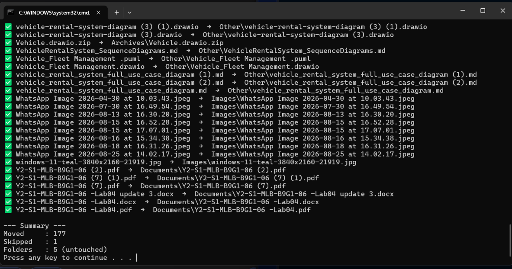

# 📂 Node.js File Organizer

A custom command-line utility built with Node.js that automatically organizes a messy directory (like a Downloads folder) by moving files into categorized subfolders (e.g., Documents, Images, Code).

## 📸 Demo


## 🚀 The Problem It Solves
Download folders quickly become chaotic. This script automates the cleanup process, saving time and keeping the workspace organized.

## ✨ Features
- **Dry-Run Safety:** Includes a `DRY_RUN` toggle to preview file moves before executing them.
- **Smart Categorization:** Maps file extensions (`.pdf`, `.ipynb`, `.sql`, etc.) to specific folders.
- **Safety Checks:** 
  - Skips files modified in the last 5 minutes (prevents moving active downloads).
  - Ignores hidden system files.
  - Handles duplicate filenames automatically (e.g., `file (1).pdf`).

## 🛠️ Tech Stack
- **JavaScript (Node.js)**
- Built-in `fs` (File System) and `path` modules.

## 💻 How to Run Locally
1. Clone this repository.
2. Ensure you have [Node.js](https://nodejs.org) installed.
3. Open `organizer.js` and configure the `DOWNLOADS` path:
   ```javascript
   const DOWNLOADS = 'C:\\Users\\YourUserName\\Downloads';