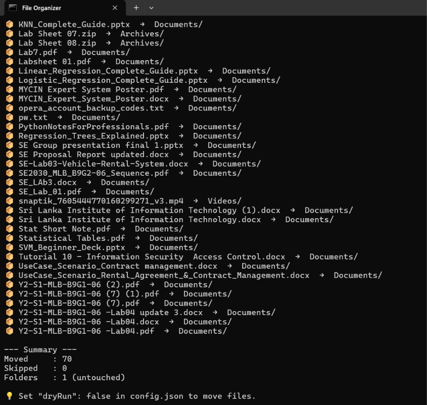
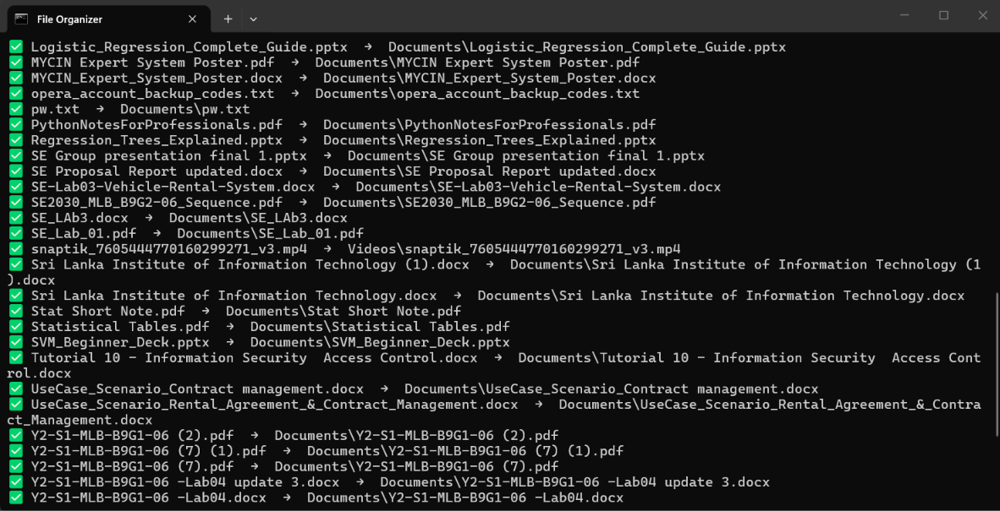
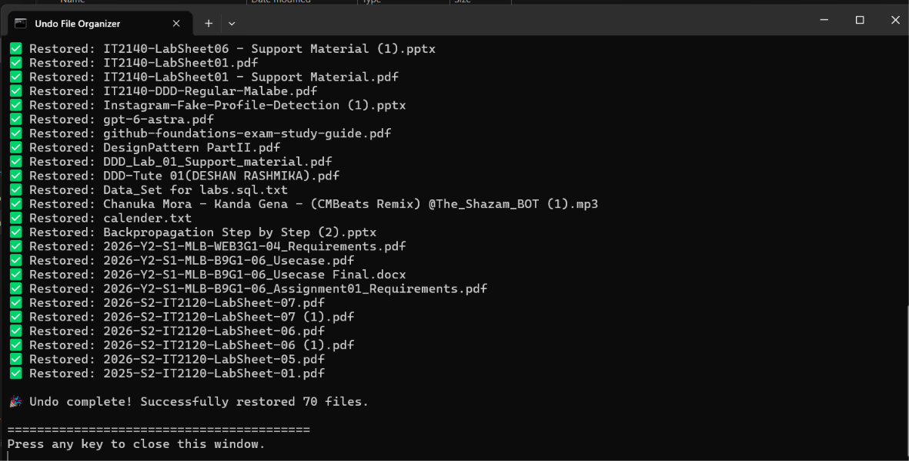

# 📂 Node.js File Organizer

A custom command-line utility built with Node.js that automatically organizes a messy directory (like a Downloads folder) by moving files into categorized subfolders (e.g., Documents, Images, Code).

## 📸 Demo

### 1. Preview the Changes (Dry Run)


### 2. Organize the Files


### 3. Undo the Changes


## 🚀 The Problem It Solves
Download folders quickly become chaotic. This script automates the cleanup process, saving time and keeping the workspace organized.

## ✨ Features
- **Custom Configuration:** Easily add your own categories and map specific file extensions without touching the code.
- **Dry-Run Safety:** Includes a `dryRun` toggle to preview file moves before executing them.
- **Undo Feature:** Made a mistake? Run the undo command to instantly move all files back to where they were.
- **Safety Checks:** 
  - Skips files modified in the last 5 minutes (prevents moving active downloads).
  - Ignores hidden system files.
  - Handles duplicate filenames automatically (e.g., `file (1).pdf`).

## 🛠️ Tech Stack
- **JavaScript (Node.js)**
- Built-in `fs` (File System) and `path` modules.

---

## 💻 How to Run Locally

### 1. Prerequisites
Ensure you have [Node.js](https://nodejs.org) installed on your computer. You can verify this by running `node -v` in your terminal.

### 2. Setup Configuration
Because this script is highly customizable, you need to set up your preferences before running it.

1. In the project folder, locate the file named **`config.example.json`**.
2. Make a copy of it and rename the copy to **`config.json`**. *(Note: The script will not work without this step).*
3. Open `config.json` in any text editor (like Notepad or VS Code) and edit the following:
   - **`targetDirectory`**: Change this to the exact path of the folder you want to organize (remember to use double backslashes `\\` for Windows paths, e.g., `"C:\\Users\\YourName\\Downloads"`).
   - **`dryRun`**: Keep this as `true` initially to preview what the script will do. Change it to `false` when you are ready to actually move files.
   - **`categories`**: Add your own custom folders and map the file extensions (e.g., `".pdf", ".mp3"`) you want inside them.

### 3. Execute the Script

#### Windows Users (The Easy Way)
You don't even need to open a terminal! Just double-click the batch files:
*   **`run.bat`** — Runs the organizer. It will preview or move files based on your `config.json`.
*   **`undo.bat`** — Instantly moves the files from your last run back to their original locations.

#### Mac / Linux Users (or terminal lovers)
Open your terminal in the project directory and run:

```bash
# To organize files:
node organizer.js

# To undo the last run:
node organizer.js --undo